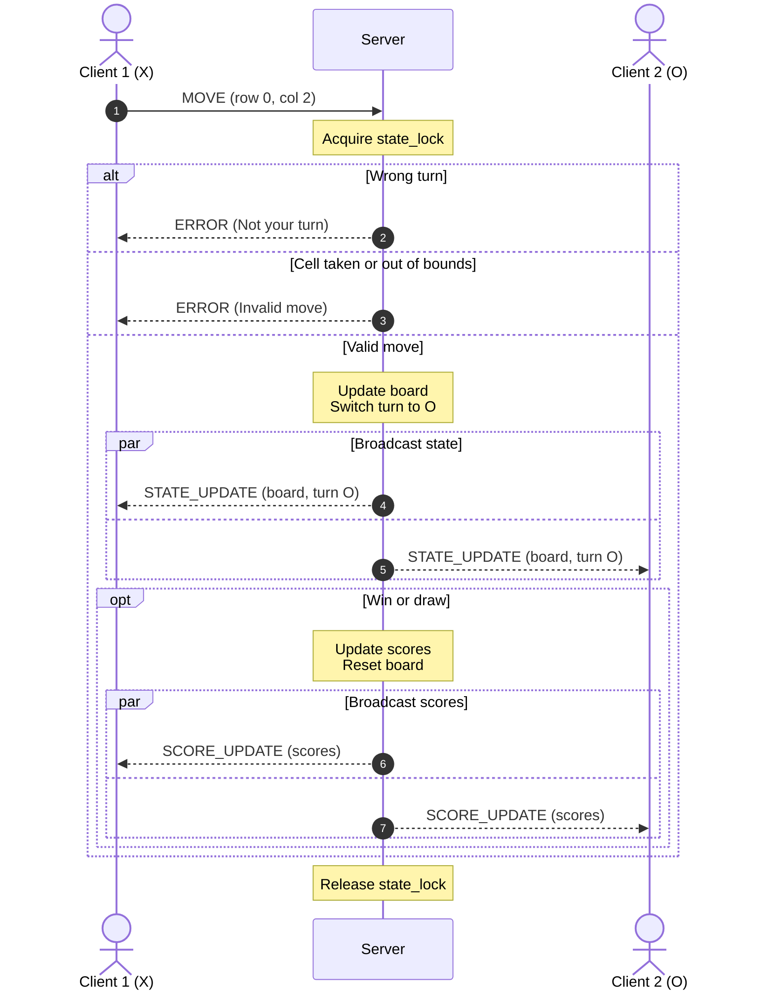

# Sprint 2: Concurrency Design — Tic-Tac-Toe Server

## 1. Concurrency Model
The server uses multi-threading. The main thread will run an accept loop on the socket, and every time a client connects, the server creates a thread to handle communication with that client.

## 2. Connection Lifecycle
### 2.1 Startup and Listening
The server creates a TCP socket, binds it to a host and port using `bind()`, and calls `listen()` to accept connections. The main thread then loops and calls `accept()`. The main thread only accepts connections, so it never gets blocked by a client.

### 2.2 Accepting and Registering Clients
When `accept()` returns a new client socket, the server gets the lock and checks how many players are connected. If there are fewer than two, the client is assigned X or O and its socket is added to the clients list. If two players are already connected, the server sends a game full error message and closes the socket. The server then starts a new worker thread for the client and goes back to `accept()`. When there are 2 players in the game, the server sends a `GAME_START` message to both clients that tells them who goes first.

### 2.3 Servicing Clients
Each worker thread loops on `recv()`. `recv()` only blocks that client's thread, not the other player or the main thread. Messages are sent as JSON with a newline at the end, like `{"type": "MOVE", "row": 0, "col": 2}`, so the thread knows where each message ends. Each `MOVE` message is handled inside the lock (see Section 3).

### 2.4 Teardown
A disconnect is detected when `recv()` returns `b''` or raises a `ConnectionResetError`. The thread then takes the lock, removes the socket from the clients list, resets the game, and tells the other player their opponent left. Then it closes the socket and the thread ends.

### 2.5 Capacity
The server can support two players, each with their own worker thread. Since each player has their own thread, one player being slow or idle doesn't block the other player or the main thread. Any additional connections above 2 are rejected.

## 3. Thread Safety and Locking Strategy

### Shared Resources
These are the variables all the threads share. All of them are protected by `state_lock`:

- **`board`**: 3x3 grid of X, O, or empty
- **`current_turn`**: whose turn it is (X or O)
- **`clients`**: list of connected client sockets
- **`scores`**: wins for X, wins for O, and draws

### Lock Strategy
The server uses one lock, `state_lock = threading.Lock()`, for all the shared state. Since there's only one lock, there's no chance of a deadlock.

The lock is held when:

- A client is added (2.2)
- A client is removed (2.4)
- A move is processed, from checking the move all the way through sending the updates:

```python
with state_lock:
    if player != current_turn:
        send(sock, ERROR, "Not your turn")
    elif not valid_cell(row, col) or board[row][col] is not None:
        send(sock, ERROR, "Invalid move")
    else:
        board[row][col] = player
        current_turn = other(player)
        broadcast(STATE_UPDATE)
        if check_win_or_draw():
            update_scores()
            reset_board()
            broadcast(SCORE_UPDATE)
```

Checking the move and changing the board happen together inside the lock. Without the lock, two threads could both see the same empty cell or both think it's their turn, and the board would get messed up. The updates are also sent while the lock is held, so both clients get them in the same order and no other move can happen until both clients have the new state.

## 4. Turn Synchronization Sequence Diagram



Client 1 sends a `MOVE` to the server. Client 1's thread gets the lock and checks if it's Client 1's turn and if the cell is empty and on the board. If either check fails, the server sends an `ERROR` only to Client 1 and nothing in the game changes. If the move is valid, the server updates the board, switches the turn, and sends a `STATE_UPDATE` to both clients. If the move wins the round or makes a draw, the server updates the scores and sends a `SCORE_UPDATE` to both clients. The lock is held the whole time, so both clients get the same updates before any other move can happen.

## 5. Score and Leaderboard Synchronization
The scores are stored in server memory in a dictionary: `scores = {"X": 0, "O": 0, "draws": 0}`. It's protected by `state_lock` like the rest of the game state. When a round ends, the server (still holding the lock) adds one to the winner's score or to draws, resets the board, and sends a `SCORE_UPDATE` with the whole scores dictionary to both clients. Since the score change and the update happen inside the same lock, both clients always see the same scores.
