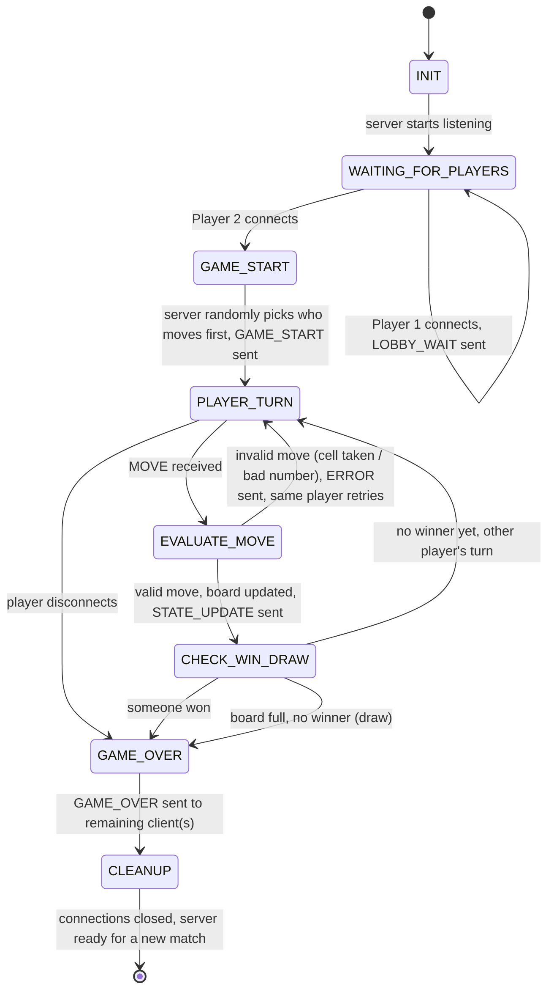

# FSM Specification

## State Diagram

## State Descriptions

- **INIT**: Server starts and listens for connections.
- **WAITING_FOR_PLAYERS**: Zero or one player connected. First player gets LOBBY_WAIT.
- **GAME_START**: Both players connected. Server randomly decides who moves first and sends GAME_START.
- **PLAYER_TURN**: Server is waiting for a MOVE from the current active player.
- **EVALUATE_MOVE**: Server checks if the submitted cell is valid and not already taken.
- **CHECK_WIN_DRAW**: Server checks the board for three-in-a-row or a full board.
- **GAME_OVER**: A result has been reached (win, draw, or forfeit) and is sent to the player(s) still connected.
- **CLEANUP**: Server closes the sockets for that match and resets, ready for a new game.

## Disconnect Handling

If a player disconnects (either by sending DISCONNECT or by the connection just dropping) while the server is in PLAYER_TURN, the server moves straight to GAME_OVER instead of waiting for a move that will never come. It sends the remaining connected player a GAME_OVER message declaring them the winner by forfeit (for example, `"result": "Player 2 wins - opponent disconnected"`), then proceeds to CLEANUP.