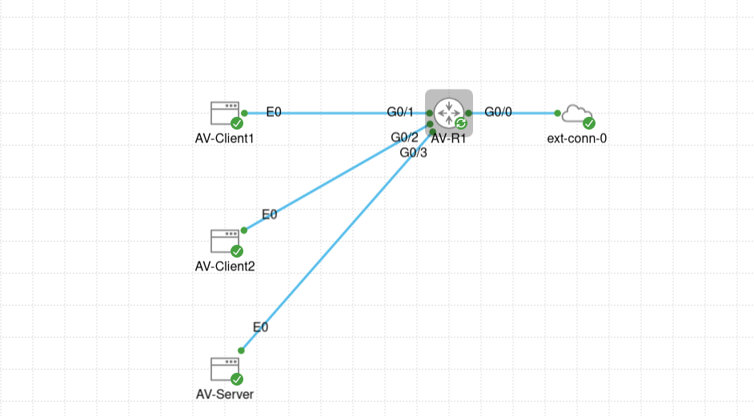
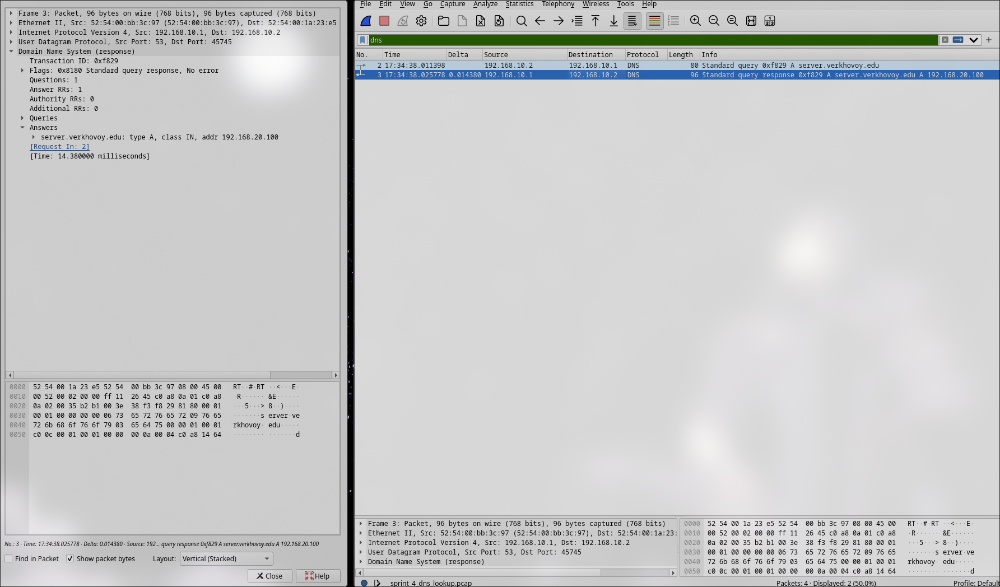

# Sprint 4 Network Report
 
Andrew Verkhovoy, CS 457
Server domain: `server.verkhovoy.edu`
 
## Topology
 

 
AV-R1 connects all three subnets. ext-conn-0 is on Gi0/0 for internet access through NAT.
 
- Gi0/1: 192.168.10.1, AV-Client1 (DHCP)
- Gi0/2: 192.168.11.1, AV-Client2 (DHCP)
- Gi0/3: 192.168.20.1, AV-Server (static 192.168.20.100)
The full router config is in `sprint_4_topology.yaml`.
 
## Router Outputs
 
### show ip interface brief
```
AV-R1#show ip interface brief
Interface                  IP-Address      OK? Method Status                Protocol
GigabitEthernet0/0         192.168.255.159 YES DHCP   up                    up
GigabitEthernet0/1         192.168.10.1    YES manual up                    up
GigabitEthernet0/2         192.168.11.1    YES manual up                    up
GigabitEthernet0/3         192.168.20.1    YES manual up                    up
NVI0                       unassigned      YES unset  up                    up
```
 
### show ip route
All three subnets show as connected (C).
```
AV-R1#show ip route
Gateway of last resort is 192.168.255.1 to network 0.0.0.0
 
S*    0.0.0.0/0 [254/0] via 192.168.255.1
      192.168.10.0/24 is variably subnetted, 2 subnets, 2 masks
C        192.168.10.0/24 is directly connected, GigabitEthernet0/1
L        192.168.10.1/32 is directly connected, GigabitEthernet0/1
      192.168.11.0/24 is variably subnetted, 2 subnets, 2 masks
C        192.168.11.0/24 is directly connected, GigabitEthernet0/2
L        192.168.11.1/32 is directly connected, GigabitEthernet0/2
      192.168.20.0/24 is variably subnetted, 2 subnets, 2 masks
C        192.168.20.0/24 is directly connected, GigabitEthernet0/3
L        192.168.20.1/32 is directly connected, GigabitEthernet0/3
      192.168.255.0/24 is variably subnetted, 2 subnets, 2 masks
C        192.168.255.0/24 is directly connected, GigabitEthernet0/0
L        192.168.255.159/32 is directly connected, GigabitEthernet0/0
```
 
### show ip dhcp binding
Both clients got leases from their own pool.
```
AV-R1#show ip dhcp binding
Bindings from all pools not associated with VRF:
IP address          Client-ID/              Lease expiration        Type
                    Hardware address/
                    User name
192.168.10.2        0152.5400.1a23.e5       Nov 22 2026 12:30 AM    Automatic
192.168.11.2        0152.5400.95c2.e0       Nov 22 2026 12:31 AM    Automatic
```
 
## Server Setup
```
AV-Server:~# ip addr add 192.168.20.100/24 dev eth0
AV-Server:~# ip link set eth0 up
AV-Server:~# ip route add default via 192.168.20.1
AV-Server:~# echo "nameserver 192.168.20.1" > /etc/resolv.conf
AV-Server:~# ip route
default via 192.168.20.1 dev eth0
192.168.20.0/24 dev eth0 scope link  src 192.168.20.100
```
 
## Client 1
```
AV-Client1:~# udhcpc -i eth0
udhcpc: started, v1.37.0
udhcpc: broadcasting discover
udhcpc: broadcasting select for 192.168.10.2, server 192.168.10.1
udhcpc: lease of 192.168.10.2 obtained from 192.168.10.1, lease time 86400
AV-Client1:~# ip addr show eth0
2: eth0: <BROADCAST,MULTICAST,UP,LOWER_UP> mtu 1500 qdisc pfifo_fast state UP qlen 1000
    link/ether 52:54:00:1a:23:e5 brd ff:ff:ff:ff:ff:ff
    inet 192.168.10.2/24 scope global eth0
       valid_lft forever preferred_lft forever
 
AV-Client1:~# ping -c 4 192.168.20.100
PING 192.168.20.100 (192.168.20.100): 56 data bytes
64 bytes from 192.168.20.100: seq=0 ttl=63 time=15.346 ms
64 bytes from 192.168.20.100: seq=1 ttl=63 time=3.971 ms
64 bytes from 192.168.20.100: seq=2 ttl=63 time=3.632 ms
64 bytes from 192.168.20.100: seq=3 ttl=63 time=4.016 ms
 
--- 192.168.20.100 ping statistics ---
4 packets transmitted, 4 packets received, 0% packet loss
round-trip min/avg/max = 3.632/6.741/15.346 ms
 
AV-Client1:~# nslookup -type=A server.verkhovoy.edu
Server:         192.168.10.1
Address:        192.168.10.1:53
 
Non-authoritative answer:
Name:   server.verkhovoy.edu
Address: 192.168.20.100
```
 
## Client 2
```
AV-Client2:~# udhcpc -i eth0
udhcpc: started, v1.37.0
udhcpc: broadcasting discover
udhcpc: broadcasting select for 192.168.11.2, server 192.168.11.1
udhcpc: lease of 192.168.11.2 obtained from 192.168.11.1, lease time 86400
 
AV-Client2:~# ping -c 4 192.168.20.100
PING 192.168.20.100 (192.168.20.100): 56 data bytes
64 bytes from 192.168.20.100: seq=0 ttl=63 time=9.504 ms
64 bytes from 192.168.20.100: seq=1 ttl=63 time=3.768 ms
64 bytes from 192.168.20.100: seq=2 ttl=63 time=5.523 ms
64 bytes from 192.168.20.100: seq=3 ttl=63 time=3.724 ms
 
--- 192.168.20.100 ping statistics ---
4 packets transmitted, 4 packets received, 0% packet loss
round-trip min/avg/max = 3.724/5.629/9.504 ms
 
AV-Client2:~# nslookup -type=A server.verkhovoy.edu
Server:         192.168.11.1
Address:        192.168.11.1:53
 
Non-authoritative answer:
Name:   server.verkhovoy.edu
Address: 192.168.20.100
```
 
Both clients ping the server with 0% loss and resolve server.verkhovoy.edu to 192.168.20.100 using R1 as DNS.
 
## Wireshark DNS Capture
 
Captured on the link between AV-Client1 and AV-R1 while running `nslookup -type=A server.verkhovoy.edu` on Client1. Filter: `dns`.
 

 
- Frame 2 is the query. Client1 (192.168.10.2) sends it to R1 (192.168.10.1) on UDP port 53, asking for the A record of server.verkhovoy.edu. ID is 0xf829.
- Frame 3 is the response. R1 sends it back to Client1 from UDP port 53 with no error, and the answer is 192.168.20.100. It has the same ID, 0xf829.